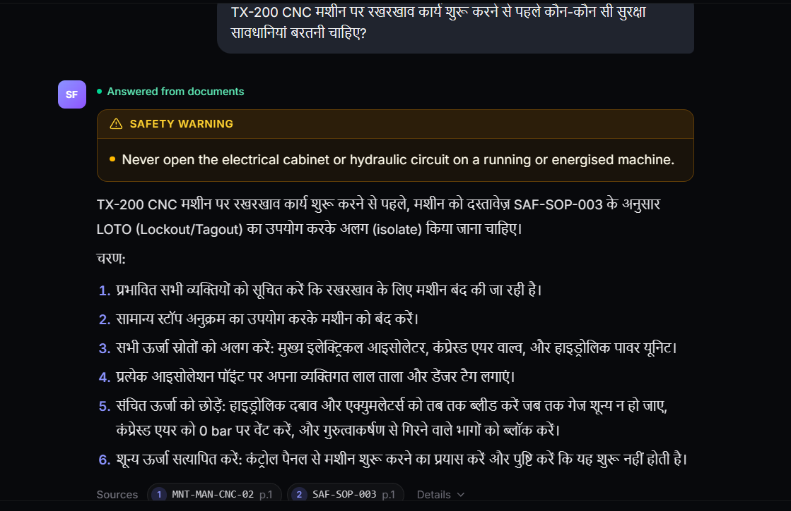
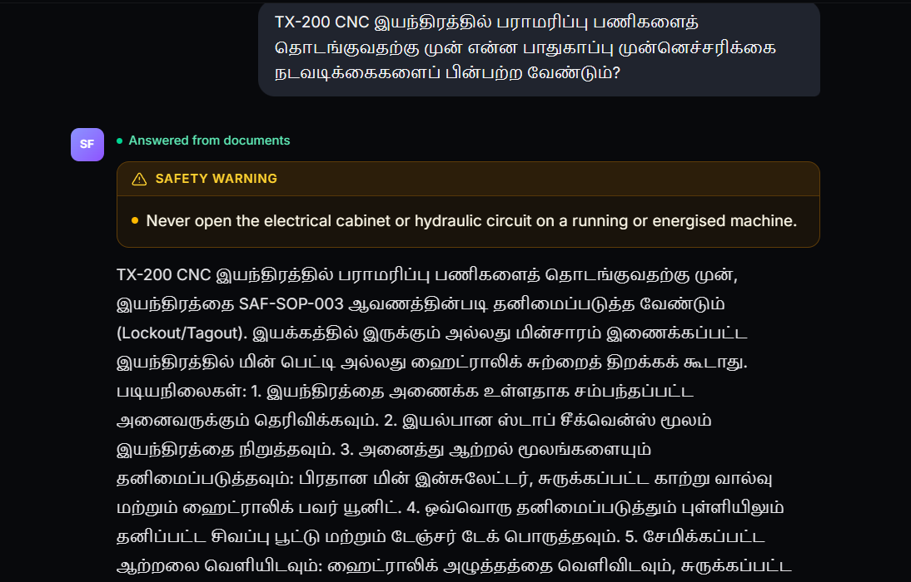

# THINKING.md

How I approached the Shop-Floor Supervisor AI Copilot: who it's for, where the AI went wrong and how I fixed it, where I used AI to challenge my own thinking, and what I'd do next.

---

## 1. Understanding the user

The person I'm building for is a manufacturing shop-floor supervisor. Their day is full of machines, shifts and safety rules, and the answers they need are spread across several SOPs, manuals and procedure documents.

When a supervisor has a doubt about how to operate a machine, how often to maintain it, or what the safety step is, they have to open three or four PDFs and search through them by hand. That takes time, and they often need the answer in the middle of a shift.

So the real problem isn't "reading PDFs." It's getting a trustworthy answer quickly and knowing where it came from. A supervisor won't act on an answer they can't verify, so the source (document, page and section) matters as much as the answer.

I built an AI copilot with RAG over the four provided PDFs. The supervisor asks a question in plain language and gets a short answer with its source. If the documents don't contain the answer, the app says so instead of guessing.

---

## 2. User journey

### My first draft (written before asking any AI)

The supervisor opens the application and logs in with their credentials. Then they ask the questions or doubts they have. The AI responds from the source documents. If the documents contain the answer, it responds with it. If not, it clearly says it can't find information related to the question.

### Where I expect this to go wrong

- The question might be unclear or too short to search properly.
- The documents might not contain the answer.
- The retrieved content might look close but not actually be relevant.
- The AI might misunderstand technical terms.
- The network might be unavailable on the shop floor.

### Revised journey (after the critique in section 3)

1. The supervisor opens the app on a laptop or phone and logs in.
2. They pick the language they want the answer in: **English, Hindi or Tamil**.
3. They type or speak a question or doubt.
4. The app searches the PDFs and only uses content that is relevant enough.
5. If it finds the answer, it replies in the chosen language with the **document, page and section**, so the supervisor can check the source.
6. If it doesn't, it says it can't find this in the documents, and the supervisor can rephrase the question or ask a person.

---

## 3. AI challenge

### How the system works

```text
Supervisor
   │
   ▼
Chat interface (Next.js)
   │
   ▼
FastAPI backend
   │
   ▼
Prompt injection guardrails
   │
   ▼
Scope classification (Gemini Flash)
   │
   ▼
Query translation (for Hindi / Tamil questions)
   │
   ▼
Embedding + vector similarity search (pgvector, active documents only)
   │
   ▼
Relevance filter (similarity threshold)
   │
   ▼
Evidence validation
   │
   ▼
Answer generation (Gemini Flash, chosen language)
   │
   ▼
Answer + safety warnings + source references
```

### Challenge 1: wrong answers and wrong citations

At the start the AI was giving wrong answers and wrong references (the citation showed the wrong page). I didn't assume the model was the problem, so I went through the pipeline step by step.

Two things were wrong:

1. **Retrieval was too loose.** My similarity threshold was `0.5`, so unrelated data was also being passed to the AI, which then built answers from it. I raised the similarity threshold so only closely related content reaches the model. If nothing passes, the app says it can't answer. The exact value is the `MIN_SIMILARITY` setting described in the `README.md`.
2. **The citation data was wrong.** I fixed my database query and chunking boundaries so it fetches the proper page and section data for the citation.

I don't treat the threshold as a guarantee. Similarity scores depend on the embedding model and the distance metric, so the number only means something for this setup.

#### How I tested it

Besides the sample questions, I wrote my own questions from the documents:

- *"The hydraulic hose on the TX-200 CNC machine needs replacement. What precautions must be taken before loosening the hose fittings, and what should be verified after installing the new hose?"*
- *"During routine maintenance, what is the acceptable hydraulic pressure range for the TX-200, and which instrument should the operator use to check it?"*
- *"For incoming BH-220 bearing housings, what inspection method is required for the bore diameter, and why can't a digital caliper be used for this measurement?"*

All three were tested successfully. The first two returned the information I asked for. For the third, the app correctly gave the required inspection method (`CMM`) and said that the documents don't explain why a digital caliper can't be used, instead of making up a reason. These are specific questions with the right machine and part names in them, so retrieval had enough to work with.

### Challenge 2: answers with extra, unrelated text

The AI answered the question but also added unrelated talk. For example, if I asked *"who are you?"*, it would introduce itself, say what it does, and invite more questions. I fixed this in the prompt so it only gives a clear answer to what was asked, nothing more. This gives a cleaner experience for the supervisor and also reduces the token cost.

### Using AI to critique my first draft

After writing my first draft of the user journey and challenges, I asked an AI to critique it.

**Prompt I used (lightly cleaned for typos):**
> Take this as my first draft and critique it. *(followed by my user journey, my two challenges, and what I'm unsure about)*

**Useful parts of the critique:**
- *"It only covers the happy path. It says nothing about choosing a language, and that's your main improvement."*
- *"'I can't find information' is a dead end. What does the supervisor do next?"*
- *"Make sure you compare similarity, not the raw distance, against 0.8. A higher threshold can also reject valid questions, especially in Hindi or Tamil."*

**What I agreed with:** When the user asks a clear question that points to the right topic, the copilot gives a correct answer. My own test questions confirmed this. I also agreed the journey was missing the language step and a next step after "can't find information."

**What I disagreed with:** I disagreed that the threshold alone is enough to protect the user. If the user doesn't give enough information, or the question is vague, the AI can still sometimes give a wrong result, so the threshold doesn't fully solve it.

**What I changed:**
- Added the language choice and the "what happens when it can't find an answer" step to the journey.
- Made the explanation of my citation fix clearer.
- Listed vague questions as a known weak spot instead of presenting the pipeline as fully reliable.

---

## 4. The improvement I added, and why

**Multilingual answers: English, Hindi and Tamil.**

I added a language selector so a supervisor can get the answer in the language they're most comfortable with. Shop-floor teams don't all read technical English easily, and an answer that's quick to understand is more likely to be followed correctly.

I picked this over other ideas because it changes who can actually use the tool. The retrieval and the source references work the same way. Only the language of the final answer changes.

The same question answered in two languages:

**Language 1 — Hindi (`hi-IN`)**


**Language 2 — Tamil (`ta-IN`)**


---

## 5. Final reflection

- **What I'd build next:** A cleaner pipeline for new document types (see below), so an admin can upload documents without me changing code. Feedback on each answer (thumbs up or down). Better handling of vague questions, for example by asking the user a follow-up question when the question doesn't have enough detail. Better retrieval, for example combining keyword and vector search for exact part names and codes. More languages after that. The app also depends on network access to reach the backend and the AI services. I'd look at local deployment and offline document retrieval for plants with unreliable connectivity.
- **What I'm unsure about:** Right now I split documents by type with fixed logic. If a new type of document is added, I have to write new logic for how to query it. A cleaner design would store a small configuration for each document type (how to chunk it, how to cite it), so when an admin uploads a file the system can detect or be told its type and configure itself, with a safe default for unknown types. I haven't built this yet, and I'm not sure how well auto-detection would work across very different documents.
  I'm also not sure whether one threshold works for every kind of document or for vague questions, and I haven't had the Hindi and Tamil answers reviewed by a native speaker who knows manufacturing terms.
- **What I'd ask the customer:**
  1. Which SOPs are the most critical, so I can test those first?
  2. How often do documents change, and who owns them?
  3. When the app isn't sure, should it say "I don't know," show the closest sections, or point to a person?
  4. Is the network reliable on the floor, and do supervisors prefer typing or speaking?
- **Biggest challenge:** Getting the right content out of the documents and attaching correct references to the answer. A good-sounding answer with the wrong page number isn't useful.
- **How I handled it:** I traced the problem through the pipeline instead of blaming the model, raised the similarity threshold so only relevant content reaches the AI, fixed my database query for citations, and tightened the prompt so answers stay focused.

